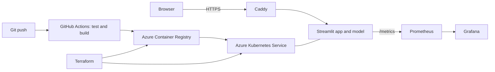

# Gesture Captions MLOps

Translates hand gestures into text captions, packaged with a complete MLOps pipeline.



The app uses MediaPipe hand landmarks with trained static, finger-spelling, and motion models, then
turns signs into English, Hindi, or Marathi sentences. See [Models](docs/MODELS.md).

## 1. Run locally

Use Python 3.12, because MediaPipe 0.10.14 doesn't support 3.13.

```bash
conda create -n gesture-mlops python=3.12 -y
conda activate gesture-mlops
pip install -r requirements-dev.txt
python -m pytest
python -m streamlit run app.py
```

Open http://localhost:8501. Metrics are at http://localhost:9100/metrics.

## 2. Run with Docker, Prometheus, and Grafana

```bash
docker compose up --build
```

| Service | Address |
|---|---|
| App | http://localhost:8501 |
| Prometheus | http://localhost:9090 |
| Grafana | http://localhost:3000 (`admin` / `admin`, local only) |

Use **Upload video** to generate traffic for the dashboard. The live webcam often can't reach a
container on Docker Desktop, so test it with `streamlit run` instead.

## 3. Push to GitHub

Create an empty repository, then run:

```bash
git init -b main
git add .
git commit -m "Initial MLOps project"
git remote add origin https://github.com/YOUR-USERNAME/gesture-captions-mlops.git
git push -u origin main
```

The `CI` workflow runs automatically. `Deploy to Azure` stays skipped until step 5.

## 4. Create Azure infrastructure

You need the [Azure CLI](https://learn.microsoft.com/cli/azure/install-azure-cli),
[Terraform](https://developer.hashicorp.com/terraform/install), and Owner access on the
subscription, because Terraform assigns roles.

```bash
az login
cd infra/terraform
cp terraform.tfvars.example terraform.tfvars   # then fill in your values
terraform init
terraform plan
terraform apply
terraform output github_settings
terraform output app_url
```

If Azure rejects the region or VM size, change `location` or `node_vm_size` in `terraform.tfvars`.

> **Azure charges while these resources exist.** Check your budget first, and run
> `terraform destroy` once you've finished your demo and screenshots.

Keep `terraform.tfstate` safe. Terraform needs it to destroy these resources later. It isn't
committed to Git.

## 5. Connect GitHub to Azure

In the GitHub repository, go to **Settings > Secrets and variables > Actions**, and add the values
from `terraform output github_settings`:

- **Secrets:** `AZURE_CLIENT_ID`, `AZURE_TENANT_ID`, `AZURE_SUBSCRIPTION_ID`
- **Variables:** `ACR_NAME`, `AKS_NAME`, `RESOURCE_GROUP`, `APP_DNS_LABEL`, `AZURE_REGION`

Then open **Actions > Deploy to Azure > Run workflow**. Later pushes to `main` deploy automatically
after CI passes. The app will be at the `app_url` address.

## 6. Check Kubernetes and Grafana

```bash
az aks get-credentials --resource-group RESOURCE_GROUP --name AKS_NAME
kubectl get pods,svc -n gesture-captions
kubectl get secret -n monitoring monitoring-grafana -o jsonpath='{.data.admin-password}' | base64 -d
kubectl port-forward -n monitoring svc/monitoring-grafana 3000:80
```

Open http://localhost:3000, sign in as `admin` with the printed password, and open the
**Gesture Captions** dashboard.

## Live webcam on Azure

Two conditions apply to the webcam, but not to the upload tabs:

1. **HTTPS:** browsers only allow camera access on HTTPS or localhost. Caddy provides HTTPS.
2. **TURN relay:** the browser can't send video directly to a pod's private address, so AKS needs a
   TURN server. Get credentials from a TURN provider, then add these GitHub secrets and redeploy:
   `TURN_URL`, `TURN_USERNAME`, and `TURN_CREDENTIAL`.

Without a TURN server, use **Upload video** on Azure and show the live webcam locally.

## Project layout

```text
app.py                 Streamlit UI
gesture_captions/      Model loading, captions, metrics, and startup
tests/                 Automated tests
Dockerfile             Container image
docker-compose.yml     Local app, Prometheus, and Grafana
.github/workflows/     CI and deployment
infra/terraform/       Azure resource group, registry, cluster, and GitHub access
k8s/                   App, HTTPS proxy, and services
monitoring/            Prometheus settings and Grafana dashboard
docs/                  Model and report guides
```

## Scaling note

The app runs one replica because Streamlit keeps each session in pod memory. Adding replicas or an
autoscaler requires sticky routing first. Each live stream also uses CPU on the pod.
